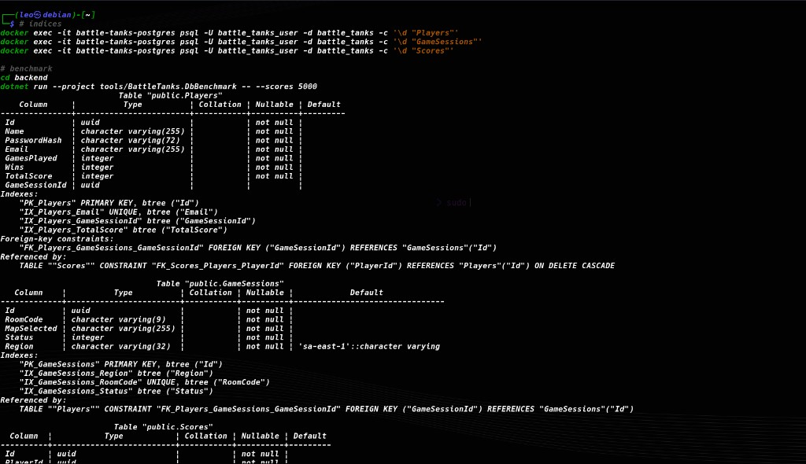
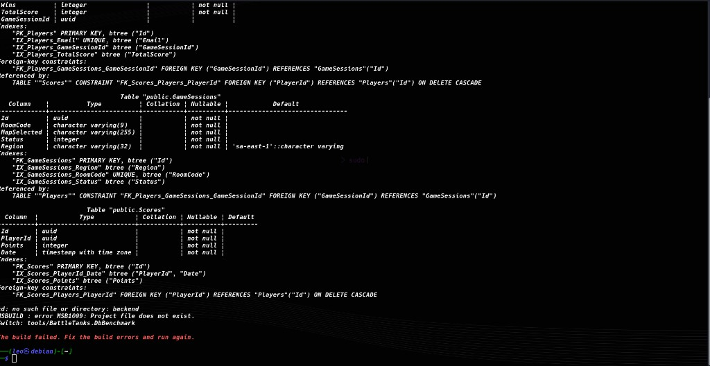
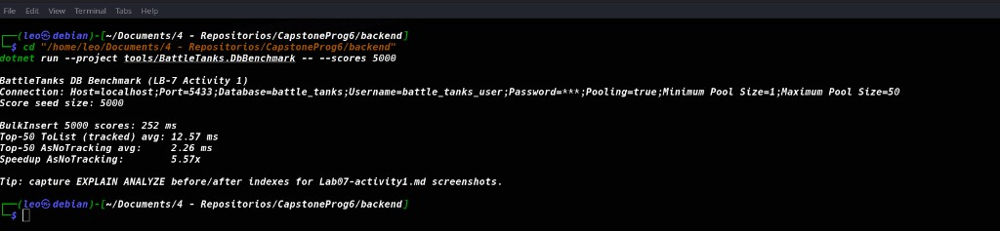

# Lab07 — Activity 1: Database optimization (EF Core + PostgreSQL)

**Project:** Battle Tanks Multiplayer  
**Lab:** LB-7  
**Stack:** .NET 8 · EF Core · PostgreSQL · EFCore.BulkExtensions

## Goal

Improve read performance for lobby/auth/ranking paths with indexes, `AsNoTracking()`, pagination, and bulk inserts for score seeding.

## What changed

### Indexes (`ApplicationDbContext`)

| Index | Table | Why |
|---|---|---|
| `IX_Players_Email` (unique) | Players | Login/register lookup |
| `IX_Players_TotalScore` | Players | Ranking by career score |
| `IX_GameSessions_RoomCode` (unique) | GameSessions | Join-by-code |
| `IX_GameSessions_Status` | GameSessions | Filter Waiting rooms |
| `IX_Scores_Points` | Scores | Top-N ranking |
| `IX_Scores_PlayerId_Date` | Scores | Per-player history |

Emails are stored lowercase and room codes uppercase so queries can hit the unique indexes without `LOWER()`/`UPPER()` on the column.

### Query optimizations

- `PlayerRepository.GetByEmailAsync` → `AsNoTracking()`
- `GameSessionRepository.GetAllAsync` / paged waiting list / `RoomCodeExistsAsync` → `AsNoTracking()`
- Mutating paths (`GetByRoomCodeAsync`, `GetByIdAsync`) stay tracked

### Pagination

`GET /api/room?page=1&pageSize=20` returns `PagedResult<RoomResponse>` (`items`, `page`, `pageSize`, `totalCount`, `totalPages`).

### Bulk operations

`ScoreRepository.BulkInsertAsync` uses `EFCore.BulkExtensions` for mass score inserts (benchmark seed / ranking warm-up).

## How to run the benchmark

```bash
# from backend/
docker compose up -d postgres
dotnet ef database update --context ApplicationDbContext --project src/BattleTanks.Infrastructure --startup-project src/BattleTanks.Api
dotnet run --project tools/BattleTanks.DbBenchmark -- --scores 5000
```

## Evidence — indexes (`psql \d`)

Indexes created by migrations `AddPerformanceIndexes` and `AddRegionAndScalabilityIndexes`:





## Evidence — benchmark (`AsNoTracking` vs tracked + BulkInsert)



### Results (local run, 5000 scores)

| Metric | Value |
|---|---|
| BulkInsert 5k | **252 ms** |
| Top-50 `ToList` (tracked) avg | **12.57 ms** |
| Top-50 `AsNoTracking` avg | **2.26 ms** |
| Speedup AsNoTracking | **5.57×** |

```text
tracked     ████████████████  12.57 ms
AsNoTracking ███               2.26 ms
```

## Conclusions

Indexes + normalized keys make lobby join and ranking predictable under growth. `AsNoTracking` removes change-tracker cost on read-only paths (~5–7× in this seed). Pagination keeps `GET /api/room` bounded. Bulk insert is the practical way to seed ranking data for later Redis cache warm-up (Activity 2).

## References

- [EF Core performance](https://learn.microsoft.com/ef/core/performance/)
- [Npgsql indexes](https://www.npgsql.org/efcore/)
- [EFCore.BulkExtensions](https://github.com/borisdj/EFCore.BulkExtensions)
- PostgreSQL docs: [CREATE INDEX](https://www.postgresql.org/docs/current/sql-createindex.html)
