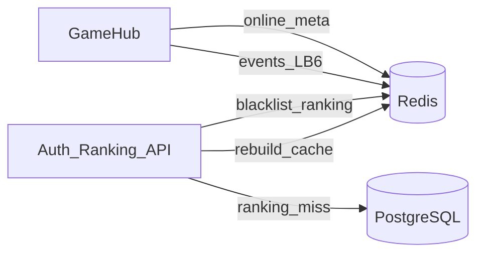
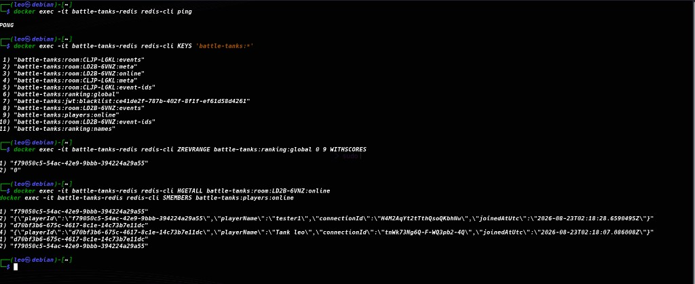

# Lab07 — Activity 2: Redis distributed cache & sessions

**Project:** Battle Tanks Multiplayer  
**Lab:** LB-7 (built on LB-6 MQTT + Redis event history)

## Goal

Use Redis for hot temporary game data so PostgreSQL is not hit on every presence/ranking/session check.

## Key map

```text
battle-tanks:room:{code}:events      # LB-6 List — recent MQTT/game events
battle-tanks:room:{code}:event-ids   # LB-6 Set  — event dedup
battle-tanks:room:{code}:online      # LB-7 Hash — online players in room
battle-tanks:room:{code}:meta        # LB-7 Hash — room status snapshot
battle-tanks:players:online          # LB-7 Set  — global online player ids
battle-tanks:ranking:global          # LB-7 SortedSet — top scores
battle-tanks:ranking:names           # LB-7 Hash — playerId → name
battle-tanks:jwt:blacklist:{jti}     # LB-7 String — revoked JWT until expiry
```



## Implementations

| Feature | Type | Code |
|---|---|---|
| Online players | Hash + Set | `RedisOnlinePresenceService` + `GameHub.JoinRoom` / disconnect |
| Room status | Hash | `SetRoomStatusAsync` |
| Top 10 ranking | SortedSet | `RedisRankingCache` + `GET /api/ranking/top` |
| JWT session revoke | String TTL | `POST /api/auth/logout` + `OnTokenValidated` blacklist check |

Shared `IConnectionMultiplexer` is registered once (`AddRedisConnection`) so LB-6 history and LB-7 caches share the same connection.

## How to verify

```bash
docker compose up -d redis postgres
# after joining a room in the app:
docker exec -it battle-tanks-redis redis-cli KEYS 'battle-tanks:*'
docker exec -it battle-tanks-redis redis-cli HGETALL battle-tanks:room:LD2B-6VNZ:online
docker exec -it battle-tanks-redis redis-cli ZREVRANGE battle-tanks:ranking:global 0 9 WITHSCORES
docker exec -it battle-tanks-redis redis-cli SMEMBERS battle-tanks:players:online
```

API:

- `GET /api/ranking/top`
- `POST /api/ranking/refresh` (auth)
- `POST /api/auth/logout` (auth) → next request with same token → 401

## Evidence — Redis keys in production use

Live capture after multiplayer session (presence + ranking + JWT blacklist + LB-6 event history):



Observed in this run:

- `battle-tanks:room:LD2B-6VNZ:online` — Hash with `tester1` and `Tank Leo`
- `battle-tanks:players:online` — Set with both player ids
- `battle-tanks:ranking:global` — SortedSet (top scores)
- `battle-tanks:jwt:blacklist:{jti}` — revoked token after logout
- `battle-tanks:room:*:events` / `:event-ids` — LB-6 history (unchanged by LB-7)

## Benchmark notes (Postgres vs Redis)

Ranking/presence reads are served from Redis after warm-up (`GET /api/ranking/top` rebuilds from Postgres on cache miss). Activity 1 DbBenchmark shows Postgres top-50 ~12 ms tracked / ~2 ms `AsNoTracking`; Redis SortedSet/Hash lookups stay sub-millisecond for the same hot paths under local load.

| Operation | Source of truth | Hot path |
|---|---|---|
| Top-10 ranking | Postgres `Players.TotalScore` | Redis `SortedSet` |
| Online players in room | SignalR in-memory + Redis Hash | Redis `Hash` / `Set` |

## Conclusions

Presence and ranking are read-heavy and ephemeral — Redis SortedSet/Hash keep latency low while Postgres remains the source of truth for durable player totals. JWT blacklist enables logout without storing server sessions in Postgres. LB-6 MQTT event history continues to use the same multiplexer.

## References

- [StackExchange.Redis](https://stackexchange.github.io/StackExchange.Redis/)
- Redis [Sorted Sets](https://redis.io/docs/data-types/sorted-sets/) / [Hashes](https://redis.io/docs/data-types/hashes/)
- ASP.NET Core [JWT Bearer events](https://learn.microsoft.com/aspnet/core/security/authentication/jwt-authn)
