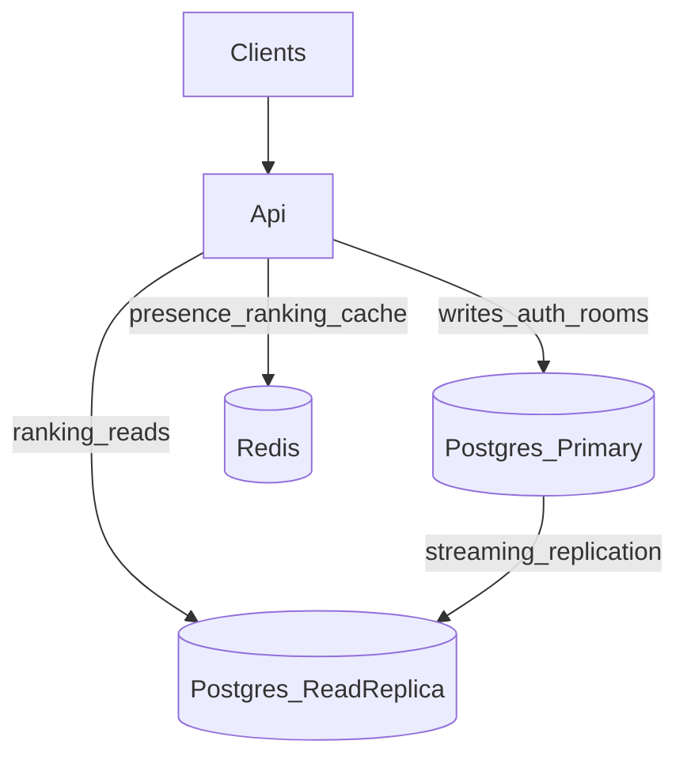

# Lab07 — Activity 3: Database design for scalability

**Project:** Battle Tanks Multiplayer  
**Lab:** LB-7

## Goal

Prepare the Battle Tanks schema and data access layer for higher concurrency: connection pooling, logical sharding by region, and a read/write split ready for PostgreSQL streaming replicas.

## What was implemented

### Connection pooling (Npgsql)

`DependencyInjection` appends pooling settings when missing:

```text
Pooling=true;Minimum Pool Size=1;Maximum Pool Size=50;Timeout=15
```

Also present in `appsettings.json` connection strings.

### Read replicas (ready)

Two DbContexts:

| Context | Connection | Tracking |
|---|---|---|
| `ApplicationDbContext` | `ConnectionStrings:PostgreSQL` | default (writes) |
| `ApplicationReadDbContext` | `ConnectionStrings:PostgreSQLRead` | `NoTracking` + SaveChanges blocked |

In local/dev both strings point to the same Postgres instance. To attach a replica later, only change `PostgreSQLRead` (host/port of the standby). Ranking reads already use `ApplicationReadDbContext`.

### Sharding concept — region key

`GameSessions.Region` (default `sa-east-1`) + index `IX_GameSessions_Region`.

Rooms can be created with an optional `region` on `POST /api/room`. Future routing can pin matchmaking / shard workers per region without rewriting the entity model.



### Optional load test

Reuse frontend scripts:

```bash
# from frontend/
node scripts/realtime-benchmark.mjs
# or
node scripts/signalr-benchmark.mjs
```

Target: observe latency while approaching ~100 concurrent SignalR connections. Capture load vs response time for the report graph.

## Replica compose (optional next step)

When hardware/time allows, add a `postgres-replica` service with `primary_conninfo` and point `PostgreSQLRead` at it. Until then, dual contexts validate the application pattern without blocking delivery.

## Evidence checklist

1. Connection string pooling flags in config / logs (`Pooling=true` in `appsettings` / benchmark connection line)
2. Diagram above (sharding + replication)
3. `Region` column + index in `\d GameSessions` — see Activity 1 print:


4. Load-test chart (connections vs p95 latency) — optional; reuse `frontend/scripts/realtime-benchmark.mjs` when capturing Lab 06/07 latency evidence

## Conclusions

Pooling absorbs bursty lobby traffic. Region is a pragmatic shard key aligned with multiplayer matchmaking. Read DbContext + separate connection string is the application-side half of replica scale-out; Redis (Activity 2) already offloads the hottest reads.

## References

- [Npgsql connection string](https://www.npgsql.org/doc/connection-string-parameters.html)
- [PostgreSQL streaming replication](https://www.postgresql.org/docs/current/warm-standby.html)
- [EF Core multiple contexts](https://learn.microsoft.com/ef/core/dbcontext-configuration/)
