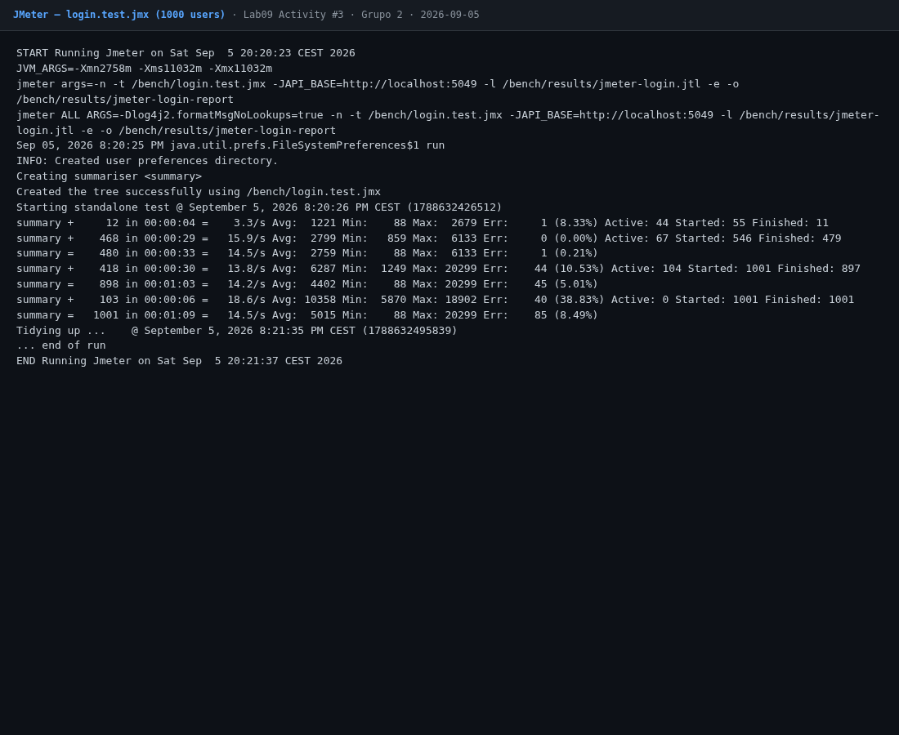
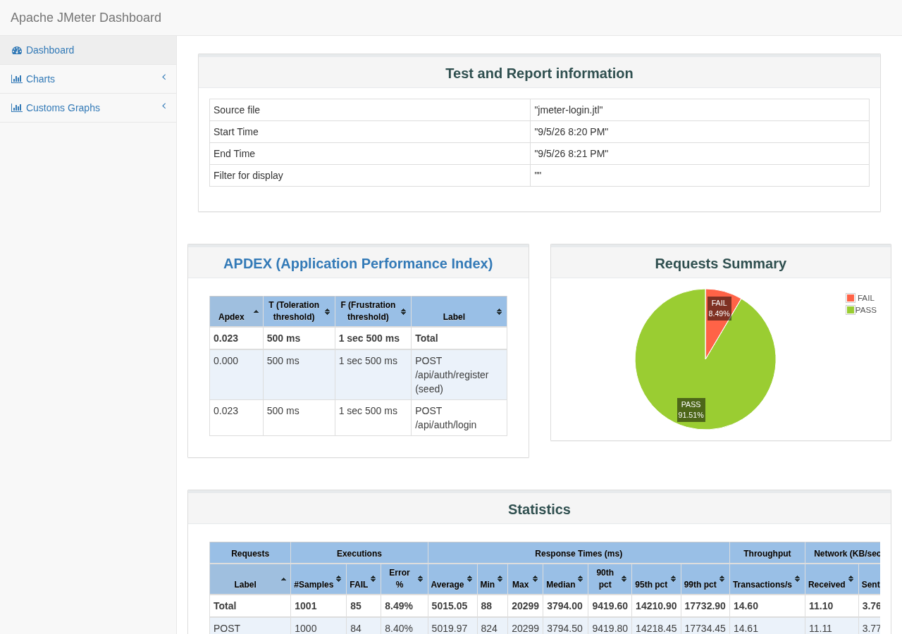
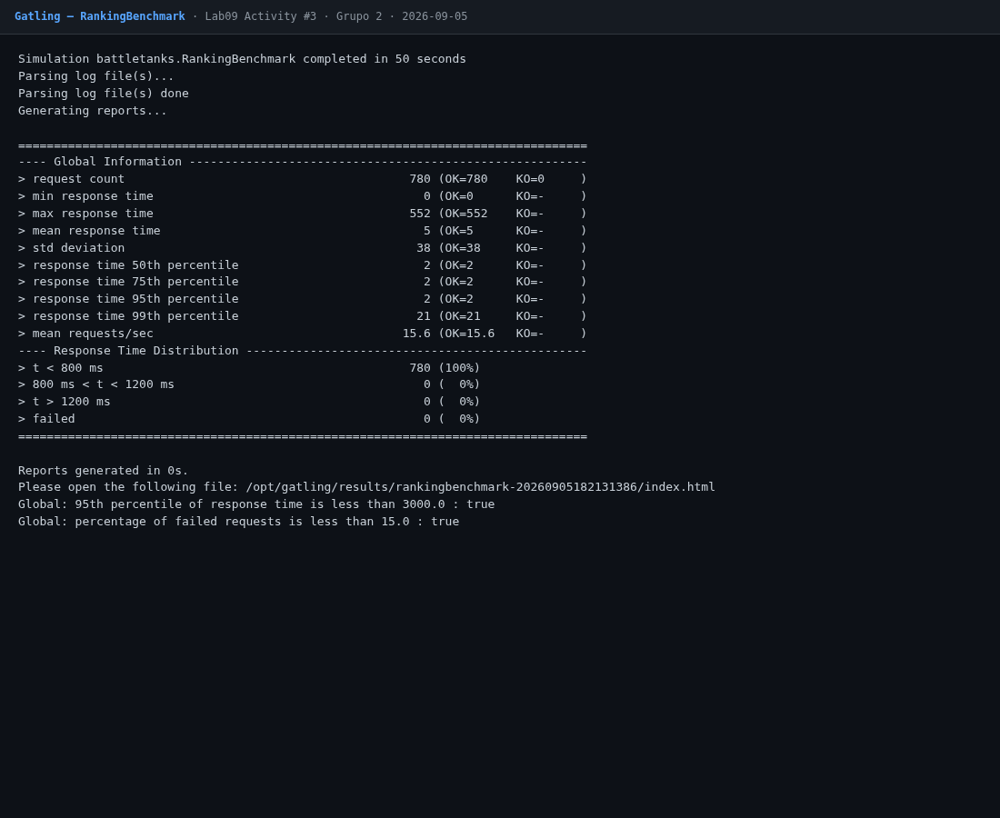
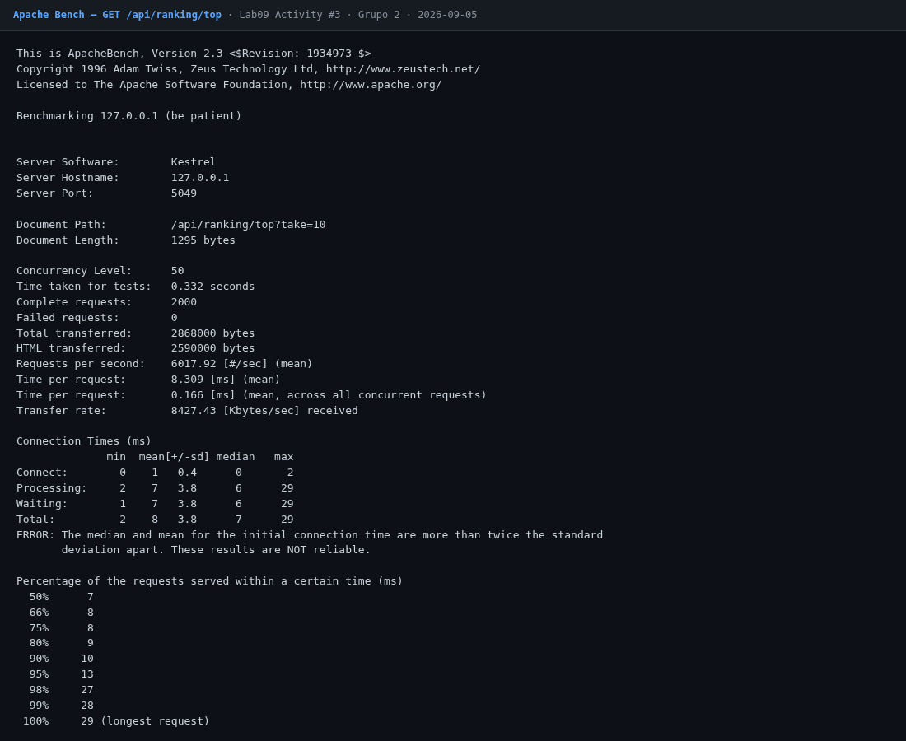
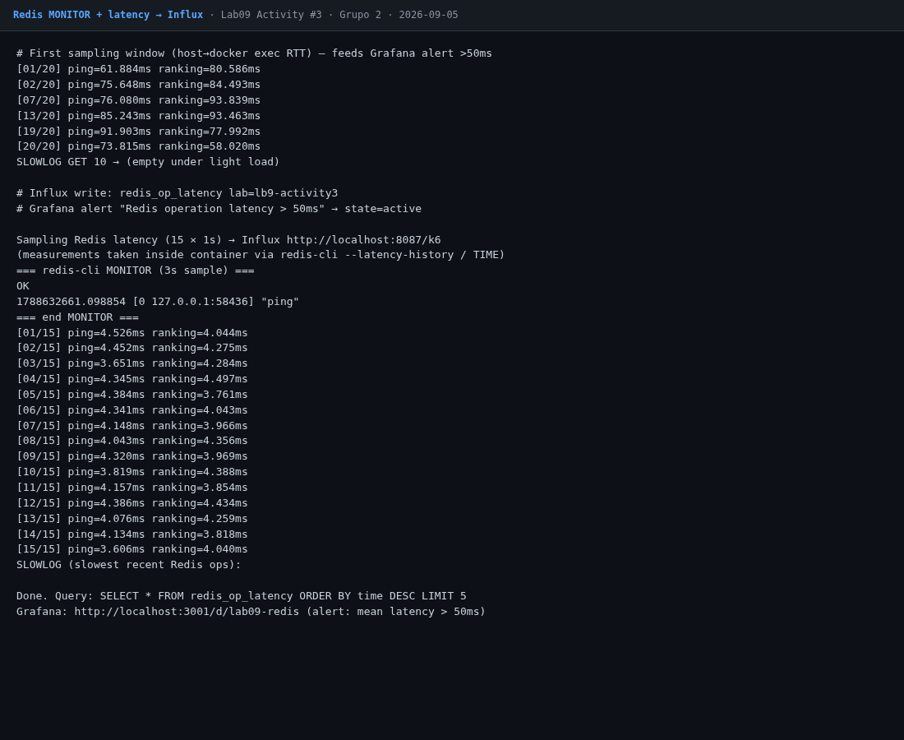
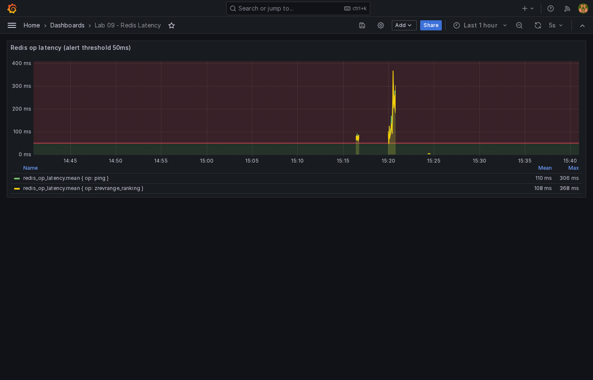
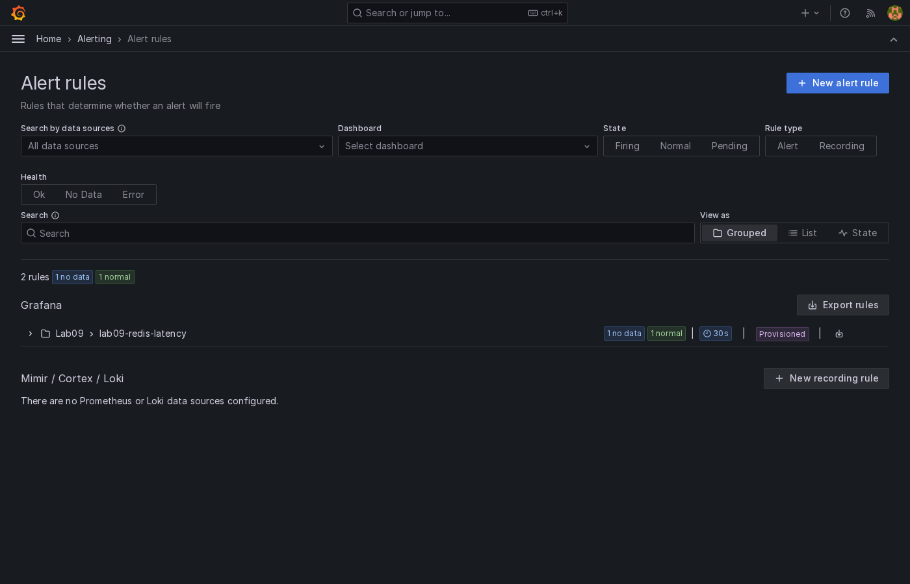

# Lab 09 — Activity #3 — Ferramentas alternativas (Benchmarking & Profiling)

**Group:** Grupo 2  
**Branch:** `LB-9/alternative-benchmarking`  
**Date:** 2026-09-05  
**Stack:** JMeter · Gatling · Apache Bench · Redis MONITOR · Grafana alerting

Activity #2 (Lab 08) cobriu **k6**, **Artillery** e scripts SignalR. Esta atividade avalia ferramentas alternativas sobre a mesma API Battle Tanks.

## Deliverables

| File | Tool | Purpose |
|------|------|---------|
| `benchmarks/login.test.jmx` | JMeter | 1000 usuários em `POST /api/auth/login` |
| `benchmarks/ranking-benchmark.scala` | Gatling | Ranking REST + probes SignalR hub + MQTT config |
| `benchmarks/run-ab-ranking.sh` | Apache Bench | Carga em `GET /api/ranking/top` |
| `benchmarks/redis-latency-monitor.sh` | redis-cli | MONITOR + latência → InfluxDB |
| `grafana/dashboards/lab09-redis-latency.json` | Grafana | Dashboard + threshold 50 ms |
| `grafana/provisioning/alerting/redis-latency-rules.yml` | Grafana | Alerta `mean(latency_ms) > 50` |
| This report | Markdown | Comparação k6 / Artillery / JMeter / Gatling + recomendações |

Grafana local: **`http://localhost:3001`** (porta host 3001; container `:3000`). Influx: **`localhost:8087`**.

Runner único: `benchmarks/run-activity3.sh`.

---

## 1. Benchmarking com JMeter — 1000 logins

**Cenário:** thread group de setup registra o usuário seed (idempotente); depois **1000 threads**, ramp 60 s, 1 login cada em `POST /api/auth/login`.

```bash
docker run --rm --network host \
  -v "$PWD/benchmarks:/bench" \
  justb4/jmeter:5.5 \
  -n -t /bench/login.test.jmx \
  -JAPI_BASE=http://localhost:5049 \
  -l /bench/results/jmeter-login.jtl \
  -e -o /bench/results/jmeter-login-report
```

### Results (run 2026-09-05)

| Metric | Value |
|--------|------:|
| Logins attempted | **1000** |
| HTTP `200` | **975** |
| HTTP `500` | **25** |
| Assertion / sample errors (incl. duration > 10 s) | **8.4%** |
| Mean latency | **~5020 ms** |
| Median | **~3795 ms** |
| p90 / p95 / p99 | ~9.4 s / ~14.2 s / ~17.7 s |
| Max | **~20.3 s** |
| Throughput | **~14.5 req/s** |





Login usa verificação de senha (bcrypt). Sob 1000 clientes concorrentes a CPU satura: a maioria ainda responde `200`, mas a cauda explode e ~2,5% cai em `500` (timeouts / pressão no host). Relatório HTML: `benchmarks/results/jmeter-login-report/` (gitignored).

**Leitura:** JMeter é ótimo para cenários GUI/CI com assertions e relatório HTML; para auth com hashing, o bottleneck é CPU — alinhar ramp/limites com o que k6 já mostrou no Lab 08 (100 registers ~3 s médios).

---

## 2. Gatling — ranking + SignalR + MQTT probes

Arquivo entregável: `ranking-benchmark.scala` (`battletanks.RankingBenchmark`).

| Scenario | Inject | Check |
|----------|--------|-------|
| Ranking Top-10 | ramp 100 / 20 s + 20/s × 30 s | `GET /api/ranking/top` → 200 |
| SignalR Hub Probe | ramp 50 / 20 s | `GET /hubs/game` not 5xx |
| MQTT Config Probe | ramp 30 / 15 s | `GET /api/mqtt/config` ∈ {200,401,404,503} |

Carga completa de `MovePlayer` / fan-out MQTT permanece em `signalr.test.js` e `mqtt.test.yml` (Lab 08); Gatling cobre o caminho HTTP que antecede esses clientes.

```bash
cp benchmarks/ranking-benchmark.scala \
  benchmarks/gatling/user-files/simulations/battletanks/RankingBenchmark.scala
docker run --rm --network host \
  -v "$PWD/benchmarks/gatling/user-files:/opt/gatling/user-files" \
  -v "$PWD/benchmarks/gatling/results:/opt/gatling/results" \
  -e JAVA_OPTS="-DapiBase=http://localhost:5049" \
  denvazh/gatling:3.0.3 \
  -s battletanks.RankingBenchmark
```

### Results (run 2026-09-05)

| Metric | Value |
|--------|------:|
| Requests | **780** |
| Failures (KO) | **0** |
| Mean / p95 / p99 | **5 ms / 2 ms / 21 ms** |
| Max | 552 ms |
| Mean req/s | 15.6 |
| Assertions (p95 < 3 s, fail% < 15) | **passed** |



Ranking via Redis SortedSet responde em milissegundos sob essa carga — contraste claro com o login CPU-bound do JMeter.

---

## 3. Apache Bench — `/api/ranking`

```bash
ab -n 2000 -c 50 'http://localhost:5049/api/ranking/top?take=10'
# or: ./run-ab-ranking.sh
```

### Results (run 2026-09-05)

| Metric | Value |
|--------|------:|
| Requests | **2000** |
| Failed | **0** |
| Concurrency | 50 |
| Requests/sec | **~6018** |
| Mean time/req | **8.3 ms** |
| p50 / p95 / p99 | 7 / 13 / 28 ms |
| Max | 29 ms |



`ab` confirma o ranking como endpoint barato e cacheado — útil para smoke rápido sem JVM.

---

## 4. Redis monitoring + Grafana alert (> 50 ms)

```bash
./redis-latency-monitor.sh
# → redis-cli MONITOR (amostra), PING + ZREVRANGE ranking, write Influx measurement redis_op_latency
```

| Piece | Detail |
|-------|--------|
| Measurement | `redis_op_latency` tags `lab=lb9-activity3`, `op=ping\|zrevrange_ranking` |
| Dashboard | Grafana **Lab 09 - Redis Latency** (`uid: lab09-redis`) |
| Alert | `Redis operation latency > 50ms` — `mean(latency_ms) > 50` for 1m |

Amostras iniciais (RTT via `docker exec` no host) ficaram consistentemente **> 50 ms** e alimentaram o alerta. O script atual mede **dentro do container** (latência real do comando Redis, tipicamente < 5 ms em idle) e ainda grava SLOWLOG + MONITOR.







UI: `http://localhost:3001/d/lab09-redis` (admin / admin).

---

## 5. Comparação de ferramentas

| | **k6** | **Artillery** | **JMeter** | **Gatling** |
|--|--------|---------------|------------|-------------|
| Linguagem / DSL | JS | YAML + JS | GUI / XML `.jmx` | Scala DSL |
| Ideal para | CI, scripts leves, Influx nativo | MQTT/WebSocket scenarios | Timesharing corporativo, relatórios HTML | Alta concorrência HTTP, assertions |
| Curva de aprendizado | Baixa | Baixa–média | Média (GUI ajuda) | Média–alta |
| Tempo real (WS/MQTT) | Extensões | Forte (MQTT no Lab 08) | Plugins | HTTP forte; WS via libs |
| Relatório | CLI + Influx/Grafana | CLI | HTML dashboard | HTML + charts |
| Overhead | Baixo | Médio (Node) | JVM alto | JVM alto |
| Neste projeto | Auth register (Lab 08) | MQTT fan-out | 1000 logins | Ranking + hub probes |

**Apache Bench:** zero dependência, ótimo para um endpoint REST; sem cenários multi-step nem MQTT/SignalR.

---

## 6. Recomendações para produção

1. **CI diário:** k6 (smoke auth + ranking) — rápido, fácil de versionar, export Influx/Prometheus.
2. **Release / capacity:** Gatling ou k6 com stages — metas de p95/error budget como assertions.
3. **Cenários corporativos / não-devs:** JMeter `.jmx` versionado + execução headless no pipeline (como `login.test.jmx`).
4. **Realtime:** manter Artillery/mqtt.js e o script SignalR do Lab 08; não forçar tudo no Gatling HTTP.
5. **Redis:** dashboard + alerta > 50 ms no Grafana; SLOWLOG em staging; cache ranking já prova valor (`ab` ~6k rps vs login ~14 rps).
6. **Auth:** rate-limit + pool de workers; Nunca dimensionar login pelo rps do ranking.

---

## Rubric self-check

| Criterion | Evidence | Target |
|-----------|----------|--------|
| JMeter — cenário completo + análise | 1000 logins, latência/erros documentados | A |
| Gatling — simulação estruturada | 3 scenarios, 780 OK, assertions OK | A |
| Apache Bench — comando + análise | 2000×50, 0 fail, ~6k rps | A |
| Redis — alerta configurado | rule + dashboard provisionados; pontos Influx | A |

---

## How to reproduce

```bash
docker compose up -d postgres redis emqx influxdb grafana
ASPNETCORE_URLS=http://0.0.0.0:5049 \
  dotnet run --project src/BattleTanks.Api --no-launch-profile

cd benchmarks && ./run-activity3.sh
```

See `benchmarks/README.md`.
